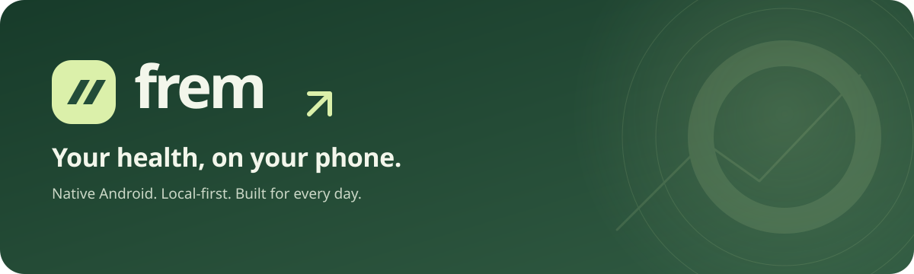
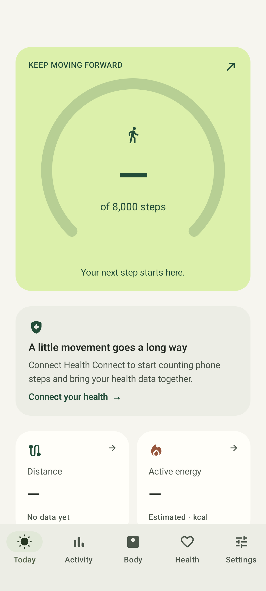
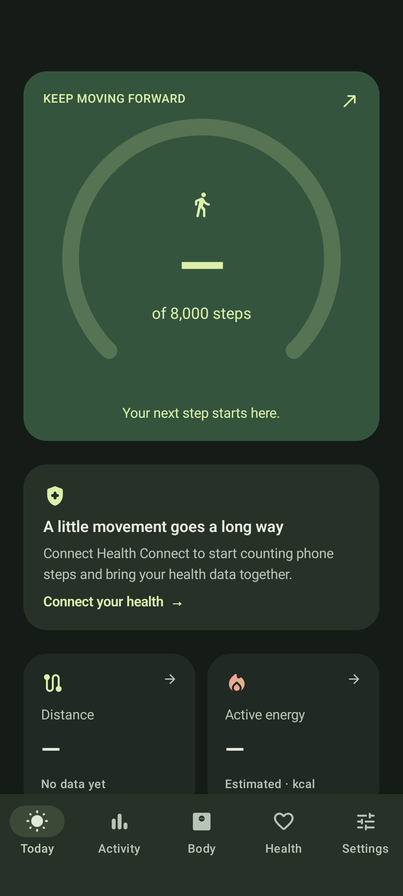

  

  
  
  

**A native, local-first Android health companion.** Built with Kotlin, Jetpack Compose, and Material 3 Expressive. No account, ads, analytics, or backend.

## Install

**Android 10 or newer.** Download the APK from [GitHub Releases](https://github.com/0xjogge/frem/releases/latest), then open it to install.

For update checks, add `https://github.com/0xjogge/frem` to [Obtainium](https://obtainium.imranr.dev/).

## Features

- Steps, distance, activity history, daily goals, and streaks.
- Weight, body measurements, hydration, and reminders.
- Sleep, heart rate, and workout imports through Health Connect.
- Light/dark themes, metric/imperial units, and CSV export.

  
  

## Documentation

- [Development](docs/development.md) — build, run, and test.
- [Releasing](RELEASING.md) — versioning and publishing.
- [Changelog](https://github.com/0xjogge/frem/releases).

## License

Frem is licensed under the [GNU General Public License v3.0](LICENSE) (`GPL-3.0-only`).
